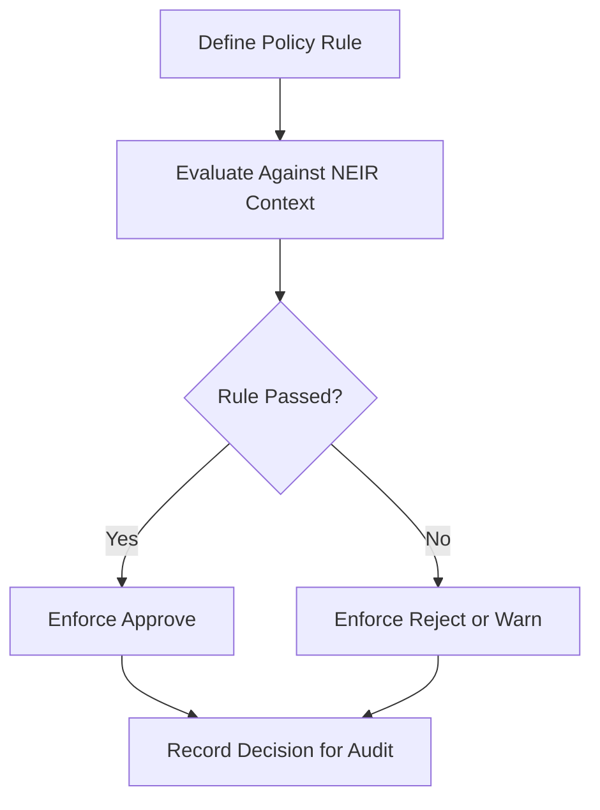
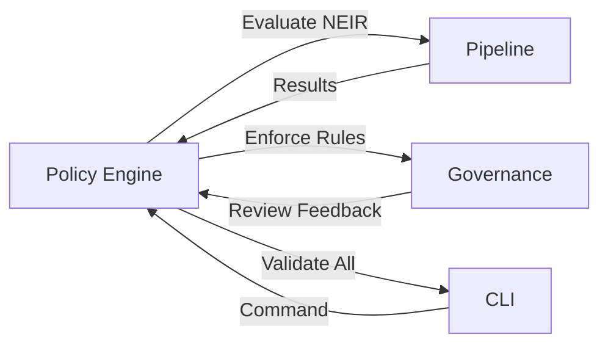

# NES-012 Policy

## 1. Status
- Status: Draft
- Version: 0.2
- Owner: NAEOS Core Team

## 2. Purpose
This specification defines the policy model used to constrain behavior across system components, generators, planners, and AI agents operating over NEIR.

## 3. Scope
The policy model covers rule definition, precedence, evaluator logic, and policy dependency resolution.

## 4. Requirements
### 4.1 Functional Requirements
- FR-001: The system shall support declarative policy definitions.
- FR-002: The policy engine shall evaluate rules according to defined precedence.
- FR-003: The system shall support 9 comparison operators.
- FR-004: The policy engine shall provide default rules for common constraints.

### 4.2 Non-Functional Requirements
- NFR-001: Policy evaluation shall be deterministic.
- NFR-002: Policy decisions shall be auditable.

## 5. Policy Model

### 5.1 Rule Structure

```go
type PolicyRule struct {
    RuleID    string
    Condition string
    Priority  int
    Action    string
    Scope     string
}
```

### 5.2 Comparison Operators

| Operator | Deskripsi | Contoh |
|----------|-----------|--------|
| exists | Field ada | exists:project |
| not_empty | Field tidak kosong | not_empty:project.name |
| contains | Mengandung string | contains:architecture.pattern,microservices |
| gt | Lebih besar dari | gt:modules.length,0 |
| gte | Lebih besar atau sama dengan | gte:services.length,1 |
| lt | Lebih kecil dari | lt:services.length,10 |
| lte | Lebih kecil atau sama dengan | lte:services.length,10 |
| in | Salah satu dari daftar | in:deployment.strategy,kubernetes,docker |
| equals | Sama dengan (default) | project.name:my-project |

### 5.3 Default Rules

| Rule ID | Kondisi | Scope |
|---------|---------|-------|
| project-required | project exists AND project.name not_empty | project |
| modules-required | modules.length gt 0 | project |
| architecture-pattern-valid | architecture.pattern in valid_patterns | architecture |
| deployment-strategy-valid | deployment.strategy in valid_strategies | deployment |
| service-port-positive | services[*].port gt 0 | service |

### 5.4 Priority

Priority menentukan **urutan evaluasi**, bukan tingkat kekuatan keputusan. Lower number = higher priority.

```
Priority 1 (Critical) → dievaluasi pertama
Priority 2 (High)
Priority 3 (Medium)
Priority 4 (Low) → dievaluasi terakhir
```

Rules dengan priority yang sama dievaluasi menurut `RuleID` secara leksikografis. Urutan ini juga menentukan rule pertama yang dicatat sebagai penyebab ketika beberapa rule gagal. Priority tidak boleh digunakan untuk membuat `ALLOW` mengalahkan `REQUIRE_APPROVAL` atau `DENY`.

### 5.5 Decision Resolution

Semua rule dalam policy yang berlaku dievaluasi. Hasil diselesaikan dengan ketentuan berikut:

1. Kegagalan evaluasi rule (evaluator mengembalikan error) menghentikan evaluasi sebagai kegagalan internal; kondisi ini bukan keputusan otorisasi.
2. Jika kondisi rule gagal, hasil policy adalah `DENY` (fail-closed). Jika beberapa rule gagal, atribusi menggunakan urutan priority menaik, lalu `RuleID` leksikografis.
3. Jika semua kondisi rule lulus, gabungkan keputusan seluruh rule yang lulus dengan keputusan default policy. Keputusan paling ketat menjadi hasil policy.
4. Precedence keputusan bersifat tetap dan tidak dipengaruhi priority:

```
DENY > REQUIRE_APPROVAL > ALLOW
```

Precedence yang sama berlaku saat menggabungkan hasil beberapa policy yang berlaku. Jika beberapa policy menghasilkan tingkat keputusan yang sama, atribusi policy dipilih secara deterministik berdasarkan `policy_id`, `policy_version`, lalu `rule_id` secara leksikografis. Urutan registrasi atau iterasi map tidak boleh mengubah hasil maupun atribusinya.

Untuk beberapa rule dengan severity yang sama, rule pertama menurut urutan evaluasi dicatat sebagai atribusi hasil; pemilihan atribusi ini tidak mengubah keputusan. Dengan demikian, priority hanya mengatur urutan evaluasi dan atribusi rule yang deterministik; priority bukan mekanisme conflict resolution.

## 6. Workflow



1. **Define** the policy rule with condition, priority, action, and scope.
2. **Evaluate** the rule against the target NEIR context.
3. **Enforce** the resulting action (approve, reject, warn).
4. **Record** the decision for audit trail.

## 7. Integration



Policy engine terintegrasi dengan:
- **Pipeline** — evaluasi policy setelah NEIR model dibangun.
- **Governance** — review artefak berdasarkan policy rules.
- **CLI** — command `validate` mengevaluasi semua policy rules.

## 8. Acceptance Criteria
- A policy rule can be defined and evaluated without custom code.
- Policy execution generates a clear and auditable decision trail.
- Default rules enforce basic project structure constraints.
- Priority ordering is respected during evaluation.
