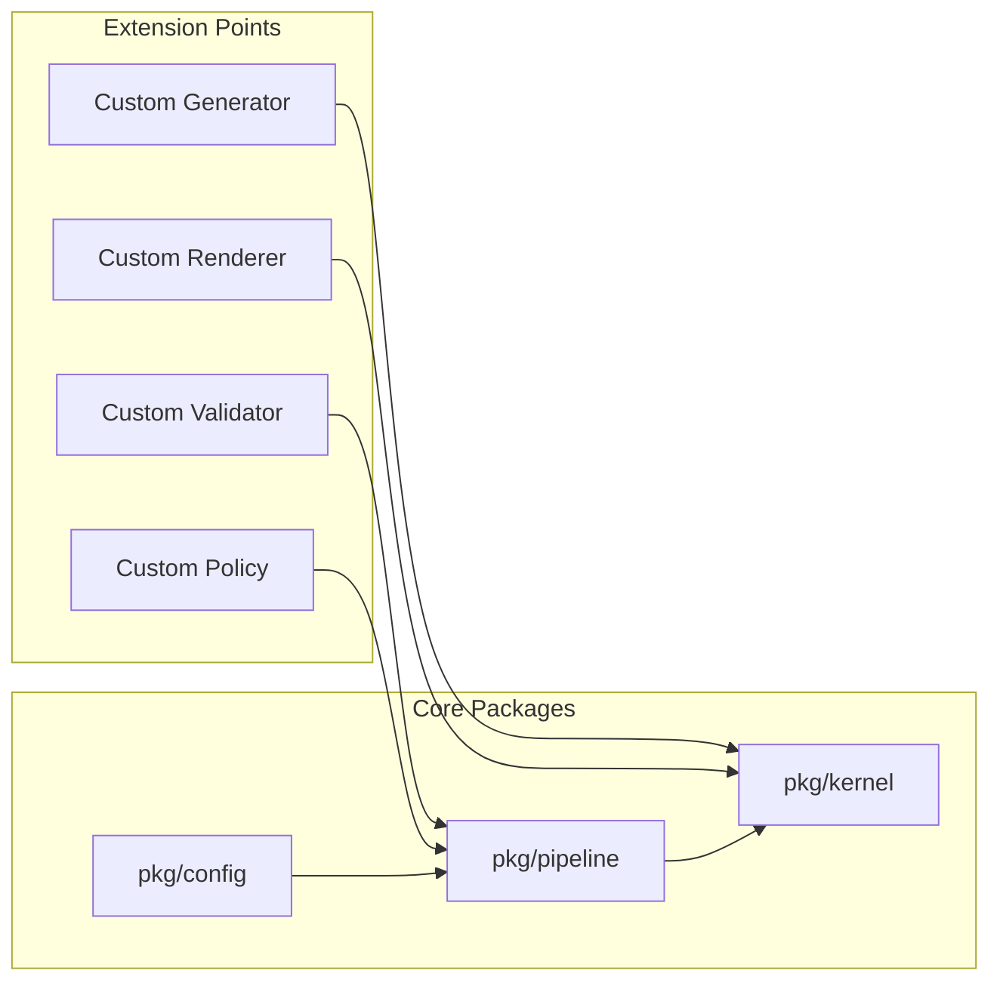

# NES-019 SDK

## 1. Status
- Status: Draft
- Version: 0.3
- Owner: NAEOS Core Team

## 2. Purpose
This specification defines the programmatic integration layer for building tools and plugins on top of NAEOS, including multi-language SDK generation.

## 3. Scope
The SDK covers public API packages (Go), multi-language output adapters, integration patterns, and extension development.

## 4. Requirements
### 4.1 Functional Requirements
- FR-001: The SDK shall expose public API packages under `pkg/`.
- FR-002: The SDK shall provide constructors and interfaces for all public components.
- FR-003: The SDK shall support custom pipeline configurations.
- FR-004: The SDK shall generate projects in 5 languages: Go, TypeScript, Python, Java, Rust.
- FR-005: The SDK shall use the OutputAdapter pattern for language extensibility.

### 4.2 Non-Functional Requirements
- NFR-001: Public APIs shall be stable and documented.
- NFR-002: SDK usage shall not require knowledge of internal packages.
- NFR-003: Each generated project shall build and run without modification.

## 5. Public Packages

| Package | Deskripsi |
|---------|-----------|
| `pkg/kernel` | Core kernel: service registry, lifecycle, event bus, telemetry |
| `pkg/pipeline` | Pipeline orchestrator |
| `pkg/config` | Configuration loader |
| `pkg/sdk` | Initial public Go façade with implementation-independent configuration and results |

### 5.1 pkg/kernel

```go
k := kernel.NewKernel()

// Service registry
k.Register("my-service", myService)

// Lifecycle
k.Initialize()
k.Start()
defer k.Stop()

// Event bus
k.Publish("topic", payload)
k.Subscribe("topic", handler)

// Telemetry
k.RecordEvent(kernel.TelemetryEvent{Name: "event", Timestamp: time.Now().Unix()})
metrics := k.Metrics()
```

### 5.2 pkg/pipeline

```go
p := pipeline.NewPipeline(config)

// Full run
results, err := p.Run("specification.yaml")

// Validate only
results, err = p.Validate("specification.yaml")
```

### 5.3 pkg/config

```go
cfg, err := config.Load("config.yaml")
// cfg.Name, cfg.Mode, cfg.Verbose, cfg.OutputDir
```

### 5.4 `pkg/sdk`

The `pkg/sdk` façade is the preferred starting point for new external Go
integrations. It intentionally exposes a smaller configuration surface than
`pkg/pipeline.Config`; internal implementation objects are converted to public
DTOs at the façade boundary. Its compatibility guarantees and remaining
capabilities are still being established; see
[the SDK boundary design](architecture/SDK-PUBLIC-API-DESIGN.md).

```go
package main

import (
    "context"

    "github.com/NAEOS-foundation/naeos/pkg/sdk"
)

func run(ctx context.Context, specification string) error {
    client, err := sdk.New(sdk.Config{
        Name: "my-project",
        Languages: []string{"go"},
    })
    if err != nil {
        return err
    }

    result, err := client.Run(ctx, specification)
    if err != nil {
        return err
    }
    for _, artifact := range result.Artifacts {
        _ = artifact.Path // consume the generated artifact
    }
    return nil
}
```

`sdk.Config` supports scalar pipeline options and public `sdk.PolicyRule`
values. Set `PolicyRule.Enabled` to `true` to activate a rule. `Mode: "governed"`
or `RequireGovernance: true` requires at least one enabled rule. `sdk.Result`
returns artifacts, task/review summaries, governance provenance, and graph
counts. Successful `Run` and `Validate` results include specification and NEIR
hashes. The SDK does not expose the internal NEIR object. The versioned public
model DTO is `pkg/neir/v1`; it types project, module, service, and metadata
sections and preserves other sections as raw JSON. `sdk.Result.NEIR` returns
this public DTO for both Run and Validate after pipeline materialization.
`Run` and `Validate` accept a
context and check cancellation before processing and between pipeline stages.
An active stage is not interrupted; cancellation is observed when that stage
returns. Cancellation during artifact writing can leave files already written
earlier in the stage.

## 6. Extension Points



| Extension | Deskripsi |
|-----------|-----------|
| Custom Generator | Tambahkan target bahasa baru |
| Custom Validator | Tambahkan aturan validasi baru |
| Custom Policy | Tambahkan aturan governance baru |
| Custom Renderer | Tambahkan engine rendering baru |

## 7. Integration Patterns

### 7.1 Embed NAEOS in Your Application

```go
import "github.com/NAEOS-foundation/naeos/pkg/kernel"

k := kernel.NewKernel()
// Register your services
// Use kernel lifecycle
```

### 7.2 Build Custom Pipeline

```go
import "github.com/NAEOS-foundation/naeos/pkg/pipeline"

p := pipeline.NewPipeline(customConfig)
results, err := p.Run("my-spec.yaml")
```

## 8. Multi-Language SDK Generation

NAEOS dapat menghasilkan proyek dalam berbagai bahasa dari satu spesifikasi.

### 8.1 Supported Languages

| Language | Build File | Package Manager | Dockerfile |
|----------|------------|-----------------|------------|
| Go | go.mod | go mod | golang:1.22-alpine |
| TypeScript | package.json | npm | node:22-alpine |
| Python | pyproject.toml | pip | python:3.12-slim |
| Java | pom.xml | maven | eclipse-temurin:21 |
| Rust | Cargo.toml | cargo | rust:1.78-alpine |

### 8.2 Configuration

```yaml
pipeline:
  name: my-project
  language:
    - go
    - typescript
    - python
```

### 8.3 OutputAdapter Interface

```go
type OutputAdapter interface {
    Language() language.Language
    GenerateProject(projectName string) []Artifact
    GenerateModule(moduleName, modulePath, projectName string) []Artifact
    GenerateService(serviceName, serviceKind string, servicePort int, projectName string) []Artifact
    GenerateDockerfile(projectName string) []Artifact
    GenerateCI(projectName string) []Artifact
    GenerateDockerCompose(projectName string) []Artifact
    GenerateArchitectureDoc(projectName, pattern string) []Artifact
}
```

### 8.4 Adding New Languages

Implement `OutputAdapter` interface and register via `init()`:

```go
type MyAdapter struct{}

func init() { Register(MyAdapter{}) }
func (MyAdapter) Language() language.Language { return "mylang" }
// ... implement all methods
```

See [NES-039 SDK Multi-Language](NES-039-SDK-MultiLanguage.md) and [NES-040 Output Adapter Architecture](NES-040-Output-Adapter-Architecture.md) for full details.

## 9. Acceptance Criteria
- Public APIs are stable and documented.
- SDK usage does not require internal package knowledge.
- Extension points support custom generators, validators, and renderers.
- Integration patterns work for embedding and standalone usage.
- Generated projects build and run in all 5 supported languages.
- New languages can be added by implementing the OutputAdapter interface.
