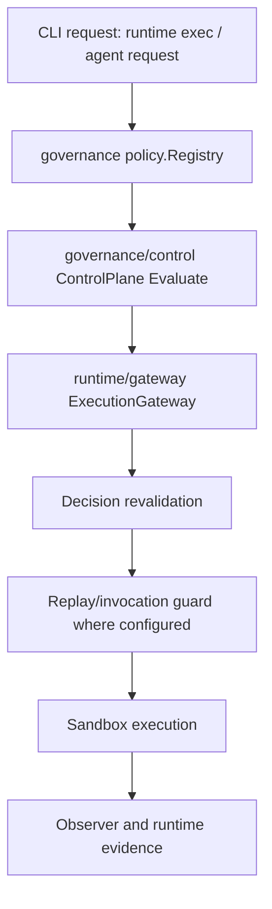

# NAEOS Authorization and Runtime Caller Map

**Status:** Static source review; runtime behavior and deployment-wide production usage are not independently verified.
**Review date:** 2026-11-05
**Related:** [Issue #713](https://github.com/NAEOS-foundation/naeos/issues/713), [NARP-001 #717](https://github.com/NAEOS-foundation/naeos/issues/717)
**Baseline:** Repository `main` caller paths inspected during this review; see GitHub links below for source.

## Purpose

Clarify the current observed authorization composition paths before changing package boundaries. Similar naming between authorization packages is not evidence that they are interchangeable or safe to consolidate.

## Observed CLI execution composition

Observed composition roots and qualifications:

- [`cmd/naeos/control_cmd.go`](https://github.com/NAEOS-foundation/naeos/blob/main/cmd/naeos/control_cmd.go) creates `internal/governance/control.New(reg)` for a standalone authorization evaluation CLI command.
- [`cmd/naeos/runtime_cmd.go`](https://github.com/NAEOS-foundation/naeos/blob/main/cmd/naeos/runtime_cmd.go) creates governance/control plus runtime/gateway and enables required decision revalidation. This command's configuration does not itself enable durable replay storage.
- [`cmd/naeos/agent_request_cmd.go`](https://github.com/NAEOS-foundation/naeos/blob/main/cmd/naeos/agent_request_cmd.go) composes the same policy/control and runtime/gateway path, enables replay protection and required revalidation, and requires explicit adapter tool/action grants. The CLI documents in-memory replay as process-local; durable/shared protection requires `--replay-db`.
- [`cmd/naeos/runtime_bridge_cmd.go`](https://github.com/NAEOS-foundation/naeos/blob/main/cmd/naeos/runtime_bridge_cmd.go) composes runtime/gateway with replay protection, required revalidation, a filesystem observer, and an adapter policy limited to filesystem writes. Its bridge persists and reconciles runtime evidence with a durable ledger.

This diagram is an observed architectural sketch, not a claim that every CLI execution mode has identical replay, persistence, or observation guarantees. Those configuration differences must be recorded per entrypoint.

## Separate controlplane API/demo composition

[ `internal/investordemo/controlplane_bridge.go`](https://github.com/NAEOS-foundation/naeos/blob/main/internal/investordemo/controlplane_bridge.go) converts investor-demo policy/grant representations to `internal/controlplane.Policy` and `Grant`, builds a `PolicyStore`, and constructs `controlplane.NewDecisionGateway` with an evaluator and ledger. It also projects legacy audit events into that ledger.

The `internal/controlplane` API has consumers in its control-plane examples and tests. The source paths sampled here do **not** show it as the authorization plane wired into the CLI runtime execution composition roots listed above.

## Package responsibilities (current observed scope)

| Package | Observed responsibility | Caller scope from this review | Boundary recommendation |
|---|---|---|---|
| `internal/governance/control` | Registry-backed policy decisions, decision records, grant digest/TTL/revocation semantics | CLI standalone evaluation and CLI/runtime gateway composition; evidence and experiments also consume contracts | Treat as the policy decision contract for the current CLI runtime path; preserve contract semantics |
| `internal/runtime/gateway` | Tool normalization, execution authorization boundary, revalidation, invocation/replay controls, sandbox, observer/evidence handling | CLI runtime exec, agent request, runtime bridge; tests and experiments | Keep enforcement and side-effect boundary downstream of policy decision |
| `internal/controlplane` | Capability/action-oriented policy/grant evaluator, approval handling, decision gateway, ledger/evidence APIs | Investor-demo bridge, examples, tests | Document as distinct demo/examples/API domain unless an explicit integration objective and ADR define a migration |
| `internal/evidence` | Decision/execution evidence contracts and verification-related records | Evidence builders and verification experiments | Preserve provenance and contract direction; do not equate with audit logging |
| `internal/audit` | Application audit events and logging | API, compliance, observability and demo-observability | Keep separate from runtime evidence absent schema/retention/integrity equivalence |

## Architecture decision

**No package consolidation or replacement is recommended by this caller map.**

For the presently observed CLI runtime path, the bounded documented sequence is:

`policy.Registry → governance/control → runtime/gateway → sandbox/observer/evidence`

`internal/controlplane` remains a distinct API/demo/examples authorization domain. It should not be described as authorizing all CLI/runtime execution or as interchangeable with governance/control.

Before proposing integration, require:
1. a stated use case and intended authoritative contract;
2. an ADR defining decision semantics, migration, compatibility, and rollback;
3. a caller inventory that includes build tags, test-only callers, and deployment composition;
4. regression coverage for deny/approval, policy/grant freshness, replay, execution side effects, and evidence integrity;
5. all relevant CI/security checks green, with no gate bypass.

## Limitations / next validation

This is a targeted static source trace. It does not establish exhaustive call coverage, production deployment wiring, or runtime guarantees. No test command was run as part of this document change. Continue with exact checkout-wide reference searches and per-entrypoint tests before any behavior or package boundary changes.

Evidence first; architectural claims remain scoped to the inspected source.
